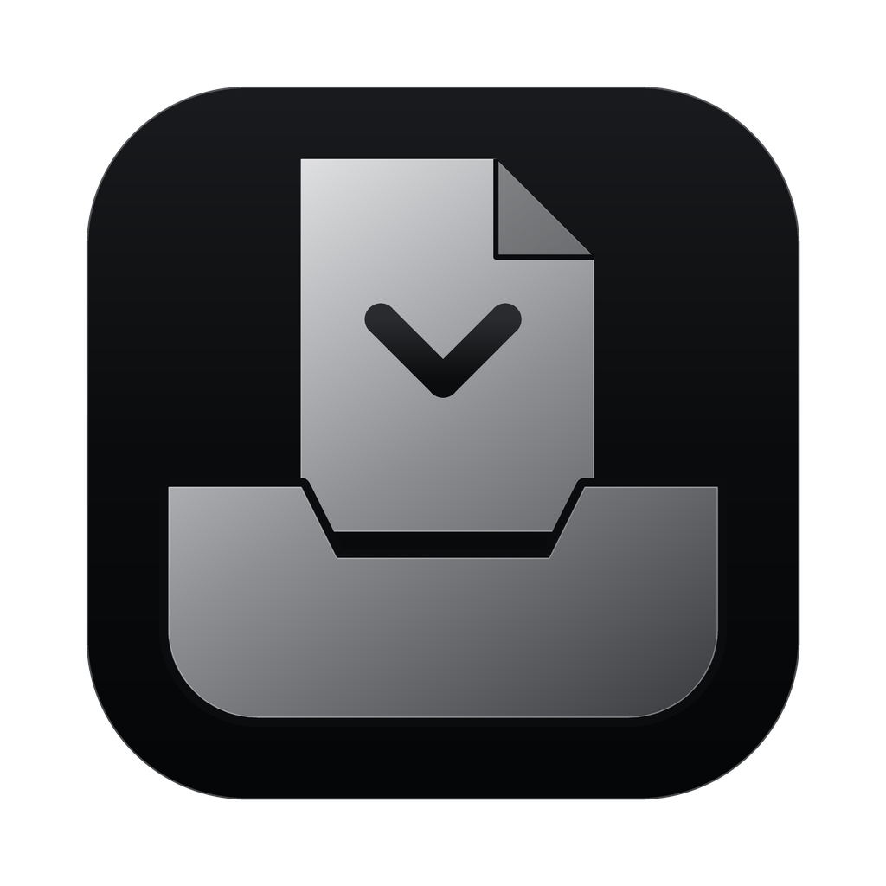

<p align="center">
  
</p>

<h1 align="center">EchoNyla</h1>

<p align="center">Files that sort themselves. A menu-bar file organizer with Apple Intelligence, running entirely on your Mac.</p>

<p align="center"><a href="https://github.com/echoappstudio/EchoNyla/releases/latest"><strong>Download the latest release</strong></a> · macOS 26+ · Apple Silicon</p>

<p align="center">
  <a href="https://github.com/echoappstudio/EchoNyla/releases/latest"></a>
  
  <a href="https://github.com/echoappstudio/EchoNyla/actions/workflows/macos-ci.yml"></a>
  <a href="LICENSE"></a>
</p>

## Features

- **Drop a file on a folder.** The menu-bar panel shows your favorite folders as tiles: drop a file on one and it goes straight there, with Undo. Drop it below the tiles, or on the menu-bar icon, and EchoNyla sorts it for you. The panel stays open until you close it, so you can pick files up in Finder without it disappearing.
- **Set up in a minute.** EchoNyla suggests favorite folders from the ones you already use in Documents and on the Desktop, each with a note saying what goes there, drafted by Apple Intelligence. Nothing is added until you tick it.
- **Files it's sure about are filed right away**, with Undo: your rules, macOS screenshots, patterns learned from your own moves, and Apple Intelligence when it's certain and backed by what's inside the file. Everything else waits for one click.
- **Apple Intelligence understands your files** on this Mac: text in PDFs and documents, text and objects in screenshots and photos, and the website a download came from.
- **You decide which folders it may use.** Give a favorite folder a short note saying what goes there (“Chase statement CSV exports only”), and Apple Intelligence suggests it only for files that plainly match. Folders without a note stay yours: drag and drop, rules and your own moves only.
- **Watches Downloads, Desktop and folders you choose.** New files are handled once they've finished downloading, with a notification to Undo or Move. Files that were already there are never touched. When you move a new file into a favorite folder yourself in Finder, EchoNyla learns from that too.
- **Clearer names.** `document (3).pdf` can become `2026-10 Lease renewal.pdf`; renames always wait for your approval.
- **A smarter on-device model (optional).** Download Ternary Bonsai 2 9B (about 3.2 GB) in Settings and it runs inside EchoNyla on the built-in llama.cpp engine. It looks at screenshots, photos and documents, gives files with useless names a proper name when it's sure, sorts files only when it can quote the folder's note, and can check a folder for files that don't belong. Every batch has Undo All.
- **Clean up any folder.** Pick Downloads, Desktop, Documents or any other folder from one menu; the main button cleans it and EchoNyla remembers it. Loose files are sorted into Sure, Guesses and No idea, with one button for every sure move, and any file can go to any folder. Approve new folders for files about one specific thing (a client, a trip, a class project), and move installers of apps you already have to Trash. Apple Intelligence's new-folder ideas are off until you turn them on. A quiet weekly reminder in the panel says when Downloads is filling up.
- **Find files in plain words**, like “the PDF from the dentist last month”, using the same index as Finder search.
- **What is this file?** A one-line summary of any file.
- **Activity** lists everything that moved, was renamed or is waiting for you, grouped by day. Everything can be undone; nothing is ever permanently deleted.
- **File type icons.** Every file shows what it is: Word, PDF, Photoshop, MP3 and over a hundred more. Pages, Keynote and other Mac types use macOS's own pictures; unknown types show their letters.
- **Signature look with six skins**: Echo App Studio's black and silver by default, light or dark with your Mac, plus Sky, Green, Turquoise, Bordeaux and Wisteria, each light and dark. The app icon in the Dock and Finder follows the skin. A sidebar for Activity, Clean Up, Find, Folders & Rules and Settings (⌘1 to ⌘5).

## Install

1. Download the ZIP from the latest release and unzip it.
2. Move **EchoNyla.app** into **/Applications**, then open it. It is signed and notarized by Apple.
3. EchoNyla updates itself: it checks for a new version when it starts and every hour, and installs it once no file is waiting to be filed. **Check for Updates…** is in the panel's menu, and **Settings → Updates** has the options.
4. Allow access to Downloads and Desktop when macOS asks (for watching), and allow notifications if you want Undo and Move buttons on them.
5. For the Apple Intelligence features, turn on **System Settings → Apple Intelligence & Siri**. Everything else works without it.

To get started, open **Folders & Rules → Suggest Folders…** (or the card on Activity) and tick the folders EchoNyla may file into. To let Apple Intelligence suggest a folder, give it a note saying what goes there.

## How it decides

1. **Your rules** always win. A folder used by a rule only receives files that match one of its rules.
2. **macOS screenshots** go to a folder named Screenshots.
3. **Patterns you taught it**: after three or more of your own moves share a subject, similar files follow. Moves count whether you click Move, drop a file on a folder tile, or move a new file in Finder.
4. **Apple Intelligence** looks at the file and picks one of the folders you described, or none. Its answer is checked: it can only choose a favorite folder that has a note, never one reserved by a rule, and only when it's sure. Guesses are dropped. It moves a file by itself only when the file's contents or download source back it up; otherwise it suggests.

Partial downloads, hidden files and installers are never moved automatically.

## Privacy

Everything happens on your Mac. EchoNyla has no analytics. The only thing it sends online is the check for a new version of itself, with GitHub. Files, names and contents are never uploaded. Apple Intelligence runs with Apple's on-device model only, never a cloud service, and long numbers such as account and card numbers are hidden from it. Reading inside files can be turned off in Settings, and so can Apple Intelligence; the app keeps working either way.

<details>
<summary>Build and test</summary>

Requires Xcode with the macOS 26 SDK.

```sh
swift test
bash Scripts/package-app.sh
bash Scripts/smoke-test.sh
```

</details>

## License

MIT. See [LICENSE](LICENSE). The file type icons in `Resources/FileTypes` come from [vscode-icons](https://github.com/vscode-icons/vscode-icons) and are licensed under [CC BY-SA 4.0](https://creativecommons.org/licenses/by-sa/4.0/); branded icons keep their owners' license. The on-device model runs on [llama.cpp](https://github.com/ggml-org/llama.cpp) (MIT). The model itself, [Ternary Bonsai 2 9B](https://huggingface.co/prism-ml/Ternary-Bonsai-2-9B-gguf) by PrismML (Apache 2.0), isn't included; EchoNyla downloads it only when you turn it on.
